# conan

> 🧭 **[How I built it →](docs/how-i-built-it.md)** scaffold first, then one phase at a time, with diagrams.

[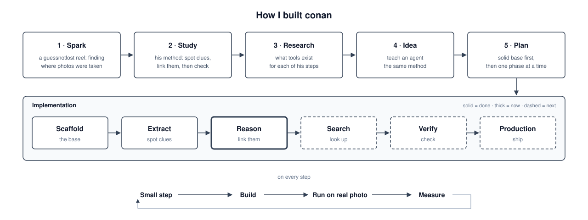](docs/how-i-built-it.md)

Image geolocation agent: give it a photo and it works out where the photo was taken. It pulls clues out of the photo, has Claude reason about them, then searches and checks candidate places.

## Aim

Act like a human geo-detective: explain *why* it thinks a photo is from a place, not just give coordinates, and get as close to the exact spot as the clues allow.

## Design

Work like a detective: **see → think → look up → confirm**. Each phase hands a clean result to the next, so each one can be built, run and checked by itself.

- **Local first:** cheap, private extraction on the machine before any LLM call.
- **Evidence over guesses:** every candidate place comes with the clues that support it.
- **Narrow step by step:** from the whole world to a region, then to a few places, then to one spot.
- **Small, focused context:** the LLM gets cleaned clues and a few crops, not raw output.
- **Saved run state:** every phase saves its results, so a run can pause for a person and resume later.
- **Human in the loop:** a person approves tool use, confirms the result, and can send the agent back to search deeper.

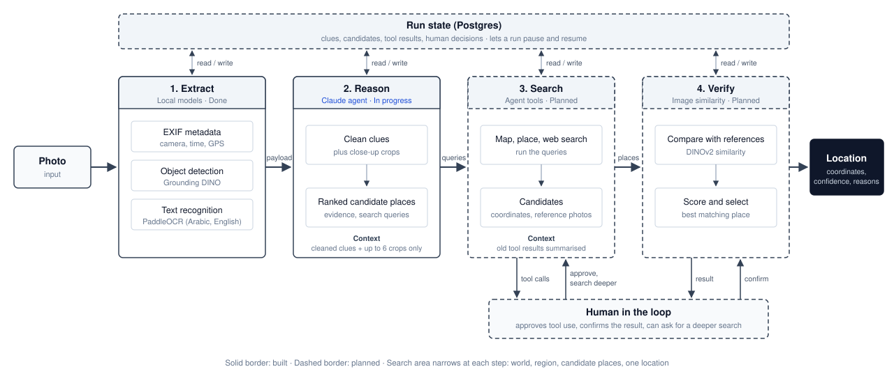

## Modules

Each module has its own README with how it works, commands, settings, decisions and open discussions:

| Module | Phase | What it does | Docs |
|---|---|---|---|
| `app/modules/engine` | 1: Extract | Pull clues from the photo, all local: EXIF, objects (Grounding DINO), text in Arabic + English (PaddleOCR) | [engine/README.md](app/modules/engine/README.md) |
| `app/modules/agent` | 2: Reason, 3: Search | Claude reasons over the clues and checks places with its tools (OpenStreetMap, Wikipedia); tool choice, approval, caching, spend | [agent/README.md](app/modules/agent/README.md) |

## Stack

FastAPI, async SQLAlchemy + Postgres, Redis, Arq worker, Strands agent with Claude.

## Setup

Needs Postgres and Redis running locally.

```bash
uv sync
cp .env.example .env        # set DATABASE_URL, REDIS_URL, ANTHROPIC_API_KEY, TOOLS_CONTACT
uv run alembic upgrade head
```

Models download on the first run (or ahead of time: [engine models](app/modules/engine/README.md#models-one-time-downloads)).

## Run

```bash
uv run fastapi dev app/main.py              # API + test UI on http://127.0.0.1:8000 (docs at /docs)
uv run arq app.worker.main.WorkerSettings   # background worker
```

### Full cycle from the CLI

```bash
uv run python -m app.modules.engine samples/photo.jpeg --out out/photo                                                # 1. extract clues
uv run python -m app.modules.engine.prepare out/photo/payload.json                                                    # 2. optional: see what the LLM gets
uv run python -m app.modules.engine samples/photo.jpeg --reason --from-payload out/photo/payload.json --out out/photo  # 3. reason + search
cat out/photo/reason.json                                                                                             # 4. read the result
```

Steps 1 and 3 in one: `uv run python -m app.modules.engine samples/photo.jpeg --reason --out out/photo`. Or the script (stops early if `ANTHROPIC_API_KEY` is missing):

```bash
scripts/full_run.sh                              # samples/photo.jpeg -> out/photo
scripts/full_run.sh samples/cafe.jpg out/cafe    # any photo and output folder
```

## Test UI

Start the API and the worker (`uv run arq app.worker.main.WorkerSettings`), open http://127.0.0.1:8000, upload a photo and press Run. The API saves an `agent:geolocation` job in the `jobs` table and queues it; the Arq worker runs it (extract, then reason) and saves the status and result on the row. The worker's printed lines go to a Redis stream (`job:{id}:log`) and the page shows them live, then the result: summary, ranked places with confidence and evidence, sources, search queries, OCR fixes, and what was sent to the LLM (crops and cleaned clues).

- **History** (left panel): every upload, newest first, with its top guess; click one to open it again. Read from the `jobs` table; files in `out/jobs/<job id>/`. Hover × to delete one, or "Delete all".
- **Extraction log** (bottom): every Phase 1 run from `out/runs.jsonl` (UI and CLI) with timings, peak RAM and device.
- **Approval:** tools that need approval show Yes / No / Allow all in the Progress card; no answer in `AGENT_APPROVAL_TIMEOUT` seconds counts as No. See [tool approval](app/modules/agent/README.md#tool-approval).
- **Tools card:** a toggle per tool; only the tools that are on go to the run. See [choosing tools](app/modules/agent/README.md#choosing-tools-per-run).
- **Top bar:** last run's tokens and cost, total spent, and credit left if `CREDIT_BUDGET` is set, e.g. `Last run: 54k tokens · $0.059 | Total: 12 runs · 650k tokens · $1.42 | Left: ~$18.58 of $20`.
- **Rate limit:** `POST /api/v1/runs` allows `RUN_LIMIT_PER_HOUR` (default 3) runs per IP per rolling hour (Redis, `app/services/rate_limit.py`); the next gets `429` with "Try again in N min". Off when `APP_ENV=local` unless `RUN_LIMIT_ON_LOCAL=true`. Behind a proxy, set `TRUST_PROXY=true`.

### Screenshots

A past run opened from History (the Wadi Rum photo, top guess Aqaba Governorate, Jordan at 82%).

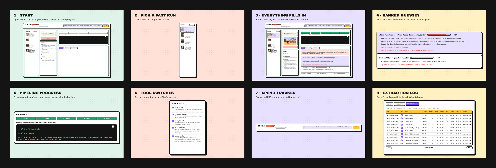

| | |
|---|---|
| 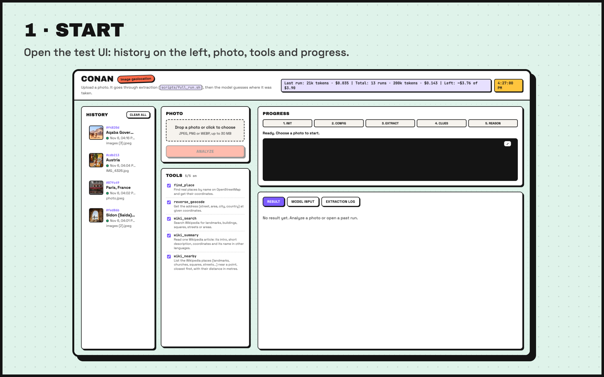 | 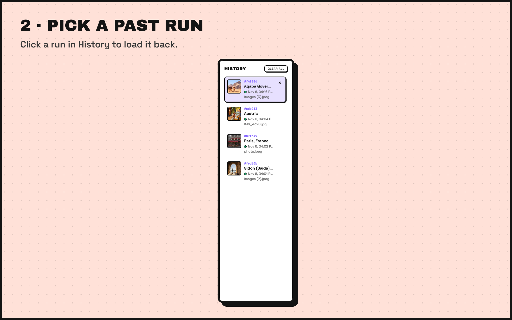 |
| 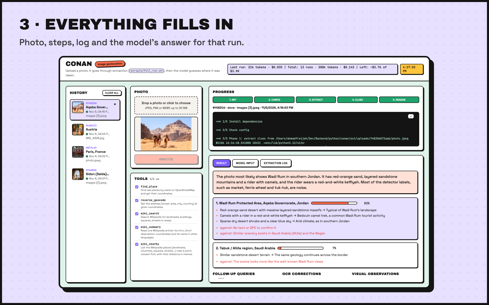 | 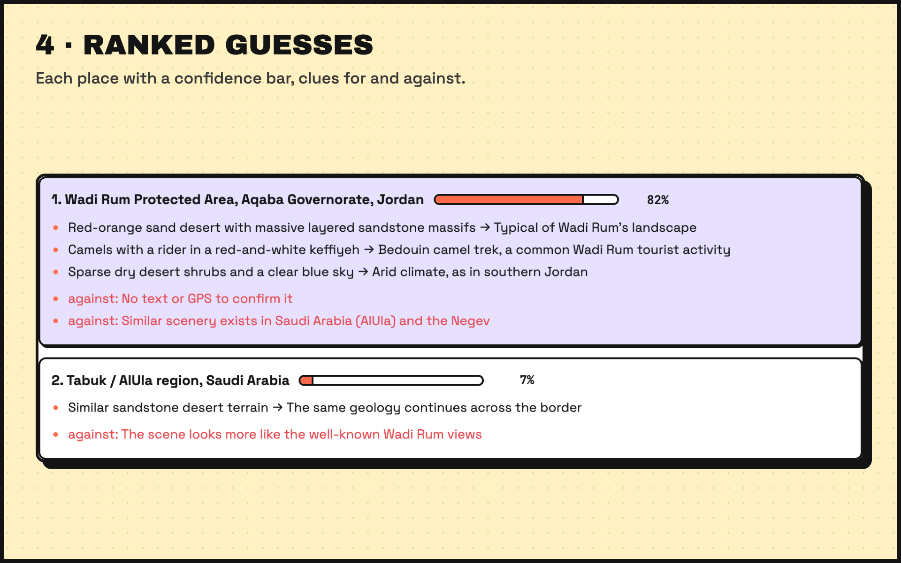 |
| 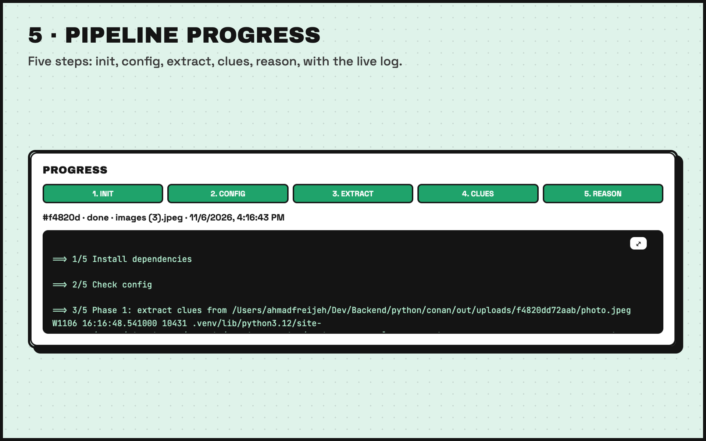 | 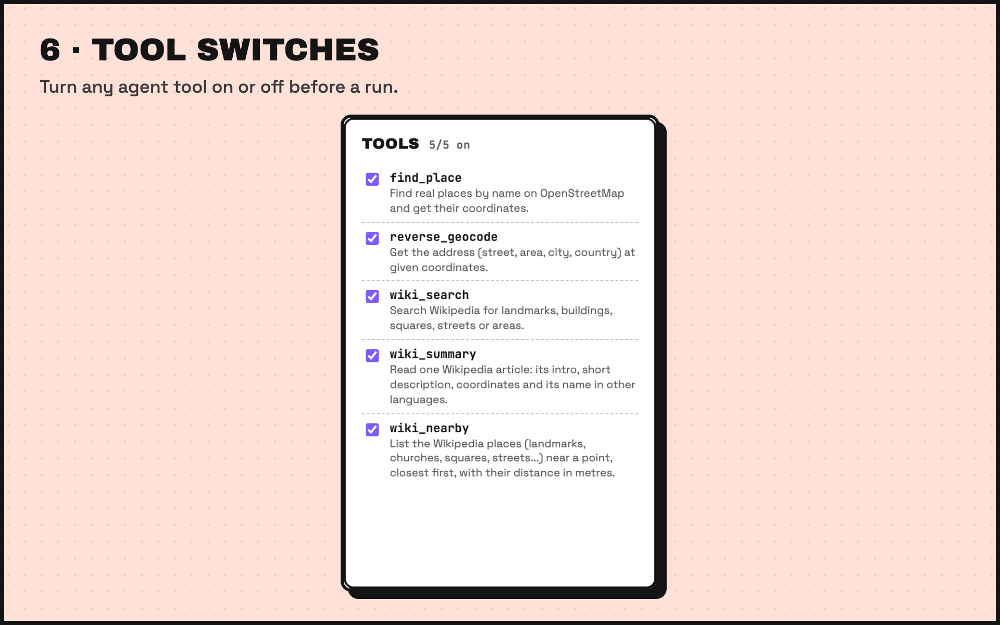 |
| 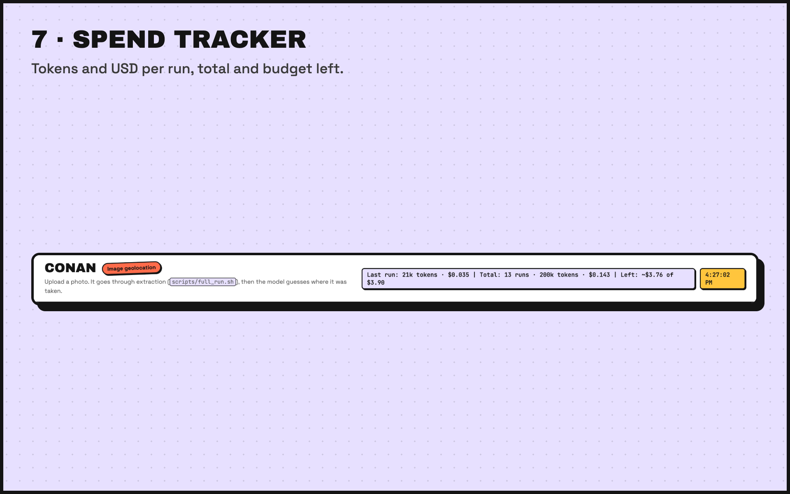 | 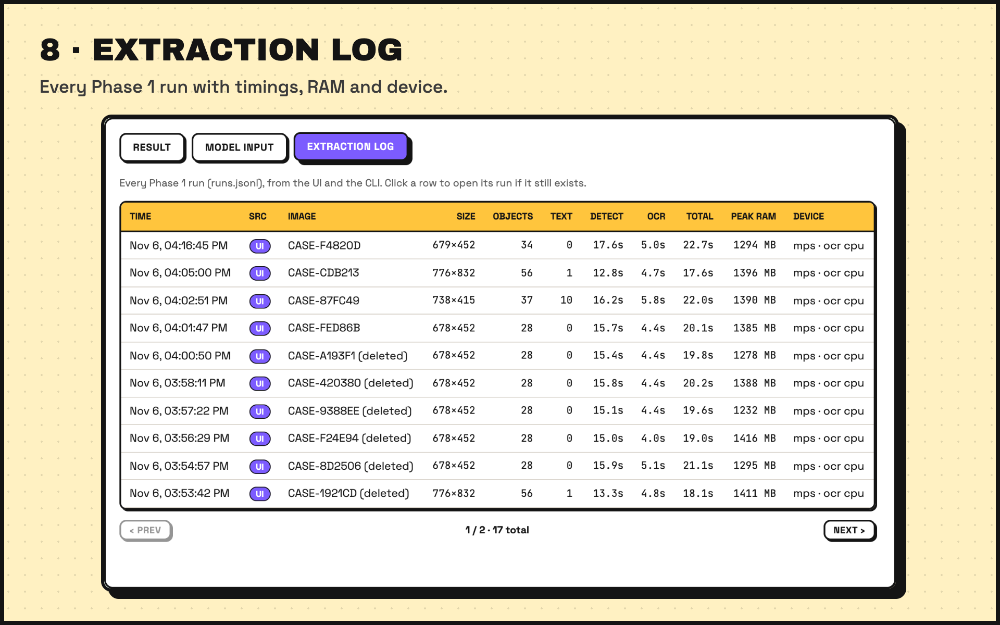 |

## Layout

- `app/api` routes and dependencies
- `app/core` config, logging, errors
- `app/db` engine, session, base model
- `app/models` ORM models
- `app/schemas` Pydantic request/response models
- `app/repositories` data access (extend `BaseRepository` per model)
- `app/services` business logic
- `app/worker` Arq background jobs
- `app/modules/engine` extraction: `extractors/` (loader, metadata, detection, ocr), `pipeline`, `prepare` (clues + crops for the agent), CLI; no FastAPI/DB
- `app/modules/agent` reasoning: `reason` (builds the agent, handles approval pauses), `hooks`, `constants` (prompt), `spend`
- `app/modules/agent/tools` the agent's `@tool` functions: `places`, `wiki`, `http` (shared `ApiClient`), `TOOLS` and `NEEDS_APPROVAL` lists, CLI
- `app/ui` test page; `app/api/v1/runs.py` + `app/services/runs.py` run the script for it

## Dev

```bash
uv run ruff check . && uv run ruff format .
```

## Roadmap

### Phase 1: Extract ✅

Objects, text and EXIF from the photo, all local. [Details](app/modules/engine/README.md).

### Phase 2: Reason 🚧

Claude reads the clues and the photo and returns ranked places with evidence. [Details](app/modules/agent/README.md).

- [x] Clean clues from the Phase 1 payload for the LLM
- [x] Send the photo plus close-up crops of key objects
- [x] Return ranked places with confidence, evidence and search queries
- [x] Test UI to run it and see the result
- [ ] Test on more photos and improve the prompt
- [ ] Check that confidence scores match how often it is right (0.9 = right about 9 times in 10)

### Phase 3: Search 🚧

Tools to look up candidate places across many sources. [Details](app/modules/agent/README.md#tools).

- [x] Map tools: `find_place` and `reverse_geocode` (OpenStreetMap)
- [x] Agent calls tools itself, retries with hints, lookup limit, cache
- [x] Tool approval in the CLI and the test UI, with a timeout
- [x] Candidate places get coordinates when a lookup confirms them
- [x] Wiki tools: `wiki_search` (fuzzy / wildcard / fragment search for OCR words), `wiki_summary`, `wiki_nearby`
- [x] Choose tools per run (UI toggles, `--tools`, `AGENT_TOOLS`)
- [x] Prompt caching and spend tracking
- [ ] `wiki_features(kind, region)`: list features of one kind in a region from Wikidata (e.g. every mountain in a province), from a fixed menu of kinds, so the agent never writes SPARQL
- [ ] Web search tool
- [ ] Pattern search on OpenStreetMap (Overpass) for cut-off shop signs in an area
- [ ] Merge results from all sources and rank places (keep places more than one clue points to)
- [ ] Find reference photos for each candidate
- [ ] Summarise old tool results so long runs stay within limits

### Phase 4: Retrieve (RAG)

Memory and reference data in a vector DB (Qdrant: local mode for dev, server or cloud later).

- [ ] Photo similarity: match the photo against geotagged reference photos (CLIP / GeoCLIP embeddings)
- [ ] Clue knowledge base: notes like plate colors, scripts, phone formats → country; `search_clues` tool
- [ ] Fuzzy place names: embed OSM place names so misread OCR signs still match
- [ ] Past runs: save solved runs and reuse them for photos with similar clues

### Phase 5: Verify

Check candidates against the photo and pick the final location.

- [ ] Compare the photo with reference photos (DINOv2 similarity)
- [ ] Score each candidate and pick the best match
- [ ] Return a final location with coordinates, confidence and the reasons why

### Production

- [ ] Run geolocation jobs in the Arq worker instead of the request
- [ ] Save runs and results to Postgres
- [ ] Set up PostGIS for location data

### Known issues

- [ ] Test UI live log sometimes shows the lines after the last approval twice (display only; `log.txt` is clean). Likely an event-stream reconnect; check for two `GET .../events` per run
