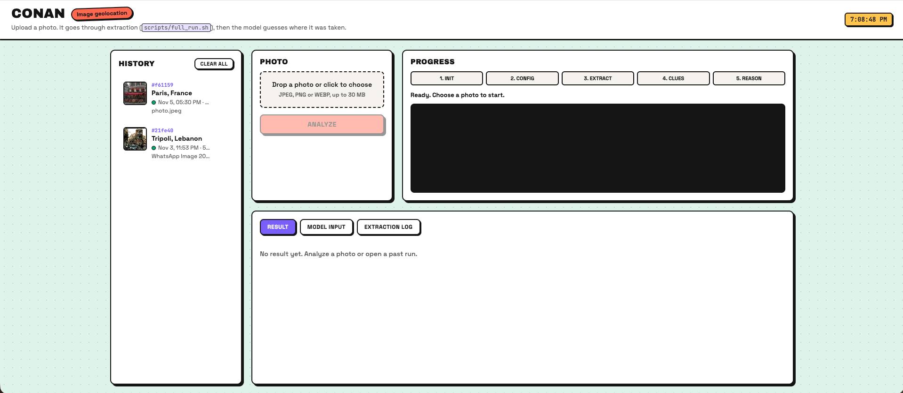
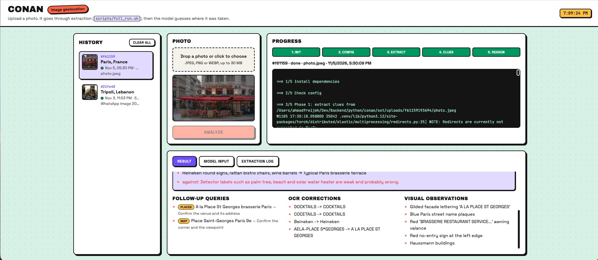
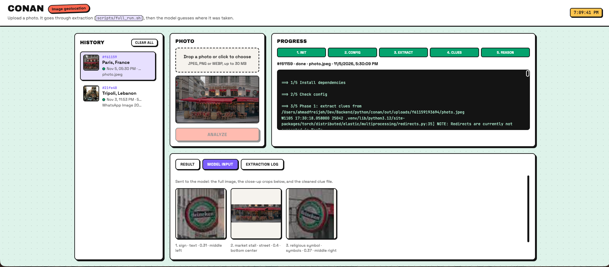

# conan

> 🧭 **[How I built it →](docs/how-i-built-it.md)** scaffold first, then one phase at a time, with diagrams.

[](docs/how-i-built-it.md)

Image geolocation agent: give it a photo and it works out where the photo was taken.

## What it does

It pulls clues out of the photo, has Claude reason about them, then searches and checks candidate places. See [Roadmap](#roadmap) for the phases.

## Aim

Act like a human geo-detective: explain *why* it thinks a photo is from a place, not just give coordinates, and get as close to the exact spot as the clues allow.

## Design Philosophy

Work like a detective: **see → think → look up → confirm**. Each phase hands a clean result to the next, so each one can be built, run and checked by itself.

- **Local first:** cheap, private extraction on the machine before any LLM call.
- **Evidence over guesses:** every candidate place comes with the clues that support it.
- **Narrow step by step:** from the whole world to a region, then to a few places, then to one spot.
- **Small, focused context:** the LLM gets cleaned clues and a few crops, not raw output; in Search, old tool results are summarised so long runs stay within limits.
- **Saved run state:** every phase reads and writes its results to Postgres, so a run can pause for a person and resume later.
- **Human in the loop:** a person approves tool use in Search, confirms the result in Verify, and can send the agent back to search deeper.


## Stack

FastAPI, async SQLAlchemy + Postgres, Redis, Arq worker, Strands agent with Claude.

## Setup

Needs Postgres and Redis running locally.

```bash
cp .env.example .env        # edit DATABASE_URL / REDIS_URL
uv sync
uv run alembic upgrade head
```

## Run

```bash
uv run fastapi dev app/main.py              # API on http://127.0.0.1:8000 (docs at /docs)
uv run arq app.worker.main.WorkerSettings   # background worker
```

## Image engine (Phase 1: Extract)

Runs every extraction step on a photo (load, EXIF, object detection, OCR) and prints the JSON payload. Steps and status: [docs/phase-1-extract.md](docs/phase-1-extract.md).

### Run

```bash
uv run python -m app.modules.engine samples/photo.jpeg                          # print the payload
uv run python -m app.modules.engine samples/photo.jpeg --out out/photo          # also save files (see below)
uv run python -m app.modules.engine samples/photo.jpeg --no-detect              # skip object detection
uv run python -m app.modules.engine samples/photo.jpeg --no-ocr                 # skip text reading
uv run python -m app.modules.engine samples/photo.jpeg --no-detect --no-ocr     # load + EXIF only (instant, no models)
```

With `--out out/photo` you get:

- `out/photo/payload.json`: the full result
- `out/photo/crops/`: one image per detected object (e.g. `03_sign.jpg`)
- `out/photo/text/`: one image per text line read (e.g. `03_CAFE.jpg`)
- `out/runs.jsonl`: one line added per run (time, CPU, GPU, memory, settings) to compare runs

Every payload has a `run` section: total and per-step time, CPU time and usage, GPU device and memory, peak RAM, machine, library versions and the settings used. GPU usage % isn't available on macOS without sudo.

Put test photos in `samples/` (JPEG, PNG or WebP). `samples/` and `out/` are git-ignored.

### Models (one-time downloads)

```bash
# Object detection: Grounding DINO tiny (~700 MB, into ~/.cache/huggingface)
uv run python -c "from transformers import AutoProcessor, AutoModelForZeroShotObjectDetection as M; m='IDEA-Research/grounding-dino-tiny'; AutoProcessor.from_pretrained(m); M.from_pretrained(m); print('dino ready')"

# OCR: text finder + English/Latin and Arabic readers (into ~/.paddlex/official_models)
uv run python -c "from paddleocr import TextDetection, TextRecognition; TextDetection(model_name='PP-OCRv5_mobile_det'); [TextRecognition(model_name=m) for m in ('PP-OCRv6_medium_rec', 'arabic_PP-OCRv5_mobile_rec')]; print('ocr ready')"
```

Missing models also download automatically on the first run.

### Settings (`.env`, all optional)

| Setting | Default | Meaning |
|---|---|---|
| `ENGINE_DEVICE` | `auto` | Object detection on `mps` (Mac GPU) or `cpu` |
| `DETECT_BOX_THRESHOLD` | `0.30` | Min object confidence |
| `DETECT_TEXT_THRESHOLD` | `0.25` | Min confidence the box matches the word |
| `DETECT_GROUPS` | `all` | Label groups to look for, e.g. `text,street,buildings`. Groups: text, food, table, interior, venue, buildings, architecture, landmarks, street, commerce, rooftops, vehicles, nature, plants, animals, symbols |
| `DETECT_BATCH_SIZE` | `25` | Labels per model run. Fewer runs = faster, longer prompts = less accurate |
| `OCR_DET_MODEL` | `mobile` | Text finder: `mobile` (fast) or `server` (more accurate) |
| `OCR_REC_MODELS` | `PP-OCRv6_medium_rec,arabic_PP-OCRv5_mobile_rec` | Text readers, comma-separated |
| `OCR_MIN_SCORE` | `0.5` | Min text reading confidence |
| `ENGINE_RUNS_LOG` | `out/runs.jsonl` | Run history file (written when `--out` is used) |

## Reasoning agent (Phase 2: Reason)

The engine prepares the agent input from the payload (clues, the photo and close-up crops, `app/modules/engine/prepare.py`). A Strands agent with Claude reads it, links the clues, checks places with its map and Wikipedia tools (see [Agent tools](#agent-tools-phase-3-search)) and returns ranked candidate places with evidence, coordinates when a lookup confirmed them, and the searches it could not run yet. Needs `ANTHROPIC_API_KEY` in `.env`.

```bash
uv run python -m app.modules.engine.prepare out/photo/payload.json                                          # see the clues sent to the LLM (no API call)
uv run python -m app.modules.engine samples/photo.jpeg --reason --out out/photo                          # Phase 1 + Phase 2
uv run python -m app.modules.engine samples/photo.jpeg --reason --from-payload out/photo/payload.json --out out/photo  # Phase 2 only, reuses the saved payload
```

The result prints and, with `--out`, is saved to `out/photo/reason.json`. At the end it prints the run's tokens and cost, e.g. `tokens: input 3000, cache read 40000, cache write 8000, output 2500 ($0.0590)`.

**Prompt caching** is on: the prompt, the tools and the conversation so far (photo and crops included) are cached on Anthropic's side, so each model call after the first in a run reads them at about 10% of the input price. The cache lives 5 minutes after its last use and survives app restarts; changing the prompt, a tool docstring or the model starts a new one.

**Spend:** every run adds one line (model, tokens, USD) to `out/spend.jsonl` (CLI and UI runs). Prices per model are in `PRICES` (`app/modules/agent/spend.py`). The test UI shows it in the top bar.

| Setting | Default | Meaning |
|---|---|---|
| `ANTHROPIC_API_KEY` | (empty) | Required for `--reason` |
| `REASON_MODEL` | `claude-sonnet-5-5` | Claude model; `claude-opus-5-5` for hard photos |
| `REASON_MAX_TOKENS` | `16000` | Max length of the answer |
| `REASON_MAX_CROPS` | `6` | Close-up crops of detected objects (signs, street, shops, vehicles, buildings) sent with the photo; `0` = photo only |
| `REASON_CACHE` | `true` | Prompt caching; `false` to turn it off (e.g. to compare cost) |
| `SPEND_LOG` | `out/spend.jsonl` | One line per reasoning run: tokens and USD |
| `CREDIT_BUDGET` | `0` | USD you topped up; the UI shows budget minus spent. `0` = hidden. An estimate: Anthropic has no balance API, so update it after a top-up |

## Agent tools (Phase 3: Search)

The agent can look things up while it reasons. Strands runs a loop: Claude picks a tool call, the tool runs, the result goes back to Claude, and Claude decides again (another call, another tool, or the answer). Our code never decides the order. Plan and status: [docs/phase-3-search.md](docs/phase-3-search.md).

| Tool | Source | What it does |
|---|---|---|
| `find_place(name, city, country)` | OpenStreetMap Nominatim (free, no key) | A name read in the photo (shop, square, street, landmark) → real places with coordinates, in English plus the local name |
| `reverse_geocode(lat, lon)` | OpenStreetMap Nominatim | Coordinates (e.g. EXIF GPS) → the address there |
| `wiki_search(query, lang)` | Wikipedia (free, no key) | Free text or a loose description ("clock tower downtown Beirut") → top articles with a short intro and coordinates. Handles misread OCR words (see below) |
| `wiki_summary(title, lang)` | Wikipedia | One article → description, full intro, coordinates and its name in other languages (local names help `find_place`) |
| `wiki_nearby(lat, lon, radius, keyword)` | Wikipedia | Coordinates from any tool or EXIF → Wikipedia places around them, closest first, with distance; `keyword` keeps e.g. only churches |

The tools chain: one finds a candidate point, the others check it against the photo.

```
find_place / wiki_search / EXIF GPS ──► candidate point (lat, lon)
                                              │
              ┌───────────────────────────────┼──────────────────────────────┐
              ▼                               ▼                              ▼
   wiki_summary(title)            wiki_nearby(point, "church")      reverse_geocode(point)
   does it look like the photo?   is the church in the photo there? which street and area?
```

Try the tools by hand (no LLM):

```bash
uv run python -m app.modules.agent.tools "Place de l'Etoile" --city Beirut
uv run python -m app.modules.agent.tools --reverse 33.8959 35.5063
uv run python -m app.modules.agent.tools --wiki "Mohammad Al-Amin Mosque Beirut"   # --lang fr / ar
uv run python -m app.modules.agent.tools --wiki "intitle:/ayzeh/ Beirut"           # cut-off OCR word
uv run python -m app.modules.agent.tools --wiki-page "Mohammad Al-Amin Mosque"
uv run python -m app.modules.agent.tools --nearby 33.8955 35.5064 --keyword church --radius 500
```

Misread or cut-off OCR words in `wiki_search` (tested on Wikipedia search):

| Pattern | For | Example |
|---|---|---|
| `word~` | 1-2 wrong letters | `Nejmh~ square` → Nejmeh Square |
| `word*` | missing ending | `Mosq* Beirut downtown` → Mohammad Al-Amin Mosque |
| `intitle:/fragment/` | missing start or middle | `intitle:/ayzeh/ Beirut` → Rue Gouraud (Gemmayzeh) |

`?` and a leading `*` do not work. When a search finds nothing, the hints suggest these retries built from the query.

During a `--reason` run every lookup is printed, e.g. `-> find_place(name="Place Saint-Georges", city="Paris", country="France")`.

How it behaves:

- **Retries:** if nothing is found, `find_place` and the wiki tools return hints (fix the spelling, drop generic words, search the street, widen the area) and the prompt tells the agent to change one thing at a time and move on after 3 misses on one clue.
- **Lookup limit:** at most `AGENT_MAX_LOOKUPS` tool calls per run, enforced in code; after that the agent is told to answer with what it has.
- **Cache:** the same request in one run returns the saved answer (no network call). Failed answers are not cached.
- **Errors:** a timeout or bad answer comes back as `{"error": ...}`, so the agent can retry or move on instead of crashing.

### Tool approval

A person can approve tool calls before they run. Tools named in `NEEDS_APPROVAL` (`app/modules/agent/tools/__init__.py`) ask every time; all tools so far are free, so the list is empty for now. Answers: **yes** (run it), **no** (skip it, the agent goes on) or **all** (allow this tool for the rest of the run).

- **CLI:** asks in the terminal: `Allow find_place(...)? [y]es / [n]o / [a]ll:`.
- **Test UI:** a box in the Progress card with Yes / No / Allow all. With no answer in `AGENT_APPROVAL_TIMEOUT` seconds it counts as no.

How an approval travels in the UI:

```
Agent (subprocess)            RunManager (server)              Browser
1. hook pauses the agent
2. prints APPROVAL {...}  ──► 3. marks run "waiting",
                                 starts the timeout      ──►  4. shows the box
                                                              5. you click Yes
                              6. POST /approval writes   ◄──
7. reads "yes", resumes  ◄──     "yes" to the agent's stdin
```

### Settings (`.env`, all optional)

| Setting | Default | Meaning |
|---|---|---|
| `AGENT_MAX_LOOKUPS` | `10` | Tool calls per run; more are cancelled |
| `AGENT_APPROVAL` | `listed` | Who asks first: `listed` = tools in `NEEDS_APPROVAL`, `all` = every tool (handy to test), `none` = nothing asks |
| `AGENT_APPROVAL_TIMEOUT` | `300` | UI only: seconds to wait for an answer, then no; `0` = wait forever. Read when the server starts |
| `PLACES_URL` | `https://nominatim.openstreetmap.org` | Map search service |
| `PLACES_TIMEOUT` | `10` | Seconds per map lookup |
| `TOOLS_CONTACT` | (empty) | Email or URL added to the User-Agent. **Needed for Wikipedia** (it answers 403 without a contact); OpenStreetMap asks for it too |
| `WIKI_URL` | `https://{lang}.wikipedia.org/w` | Wikipedia API base; `{lang}` = `en`, `fr`, `ar`... |
| `WIKI_TIMEOUT` | `10` | Seconds per Wikipedia lookup |

### Add a tool

1. Write it in its own file in `app/modules/agent/tools/` with `@tool`; the docstring is what Claude reads to decide when to use it.
2. If it calls a web API, use `ApiClient` (`tools/http.py`): timeout, User-Agent, wait between calls, cache, and errors as `ToolError`.
3. Add it to `TOOLS` in `tools/__init__.py`. If it is paid or slow, add its name to `NEEDS_APPROVAL` too.

## Full cycle

```bash
uv sync                                                                  # 1. install (once)
cp .env.example .env                                                     # 2. config (once), then set ANTHROPIC_API_KEY
uv run python -m app.modules.engine samples/photo.jpeg --out out/photo           # 3. Phase 1: extract clues (models download on first run)
uv run python -m app.modules.engine.prepare out/photo/payload.json                  # 4. optional: check the clues the LLM will get
uv run python -m app.modules.engine samples/photo.jpeg --reason --from-payload out/photo/payload.json --out out/photo  # 5. Phase 2: reason
cat out/photo/reason.json                                                # 6. read the result
```

Steps 3 and 5 can be one command: `uv run python -m app.modules.engine samples/photo.jpeg --reason --out out/photo`.

Or run all steps with one script (it stops early if `ANTHROPIC_API_KEY` is missing):

```bash
scripts/full_run.sh                              # samples/photo.jpeg -> out/photo
scripts/full_run.sh samples/cafe.jpg out/cafe    # any photo and output folder
```

## Test UI

```bash
uv run fastapi dev app/main.py    # then open http://127.0.0.1:8000
```

Upload a photo and press Run. The server runs `scripts/full_run.sh` on it, streams the log live (steps 1/5 to 5/5), then shows the result: summary, ranked places with confidence and evidence, search queries, OCR fixes. It also shows what was sent to the LLM: the close-up crops and the cleaned clues.

The left panel is the history: every upload, newest first, with its top guess. Click one to see its photo, log, result and inputs again. It is read from `out/uploads/<run id>/` (photo, `run.json`, `log.txt`, `payload.json`, `clues.json`, `sent/`, `reason.json`), so it survives restarts. At the bottom, the extraction log lists every Phase 1 run from `out/runs.jsonl` (UI and CLI): time, image, size, objects, text lines, detect/OCR/total time, peak RAM and device; hover a row for its settings, click a UI row to open that case. Hover a run and click × to delete it, or use "Delete all" (both ask first; a run that is still going is kept). One run at a time; local testing only.

Tool approval: if a tool needs approval (`NEEDS_APPROVAL`, or `AGENT_APPROVAL=all` in `.env` to ask for every tool), the Progress card shows the call the agent wants to make with Yes / No / Allow all. The run waits until you answer, or `AGENT_APPROVAL_TIMEOUT` seconds (default 300) pass; then it counts as No. The log shows each request and answer as `[approval] ...` lines. See [Tool approval](#tool-approval).

Top bar: last run's tokens and cost, total spent, and (with `CREDIT_BUDGET` set) about how much credit is left, e.g. `Last run: 54k tokens · $0.059 | Spent: $1.42 | Left: ~$18.58 of $20`. "Left" turns red under 10%. It comes from `GET /api/v1/runs/spend`.

From the CLI, `--reason --out <dir>` saves the same `clues.json` and `sent/` (crops + `crops.json`) before calling the LLM.

### Screenshots

Ready to start: history on the left, photo upload, the five progress steps.



A finished run: follow-up queries, OCR fixes and what the model saw in the photo.



Model input: the close-up crops sent to the LLM, with label, group, score and position.



## Dev

```bash
uv run ruff check . && uv run ruff format .
```

## Layout

- `app/api` routes and dependencies
- `app/core` config, logging, errors
- `app/db` engine, session, base model
- `app/models` ORM models
- `app/schemas` Pydantic request/response models
- `app/repositories` data access (extend `BaseRepository` per model)
- `app/services` business logic
- `app/worker` Arq background jobs
- `app/modules/engine` image extraction engine: `extractors/` (loader, metadata, detection, ocr), `pipeline`, `prepare` (clues + crops for the agent), `schemas`, `constants`, `helpers`, CLI; no FastAPI/DB
- `app/modules/agent` the reasoning agent: takes the input the engine prepared and returns the result (`reason` builds the agent and handles approval pauses, `hooks` (lookup limit, approval, printing), `schemas`, `constants` with the prompt, `helpers`, `spend` (token cost and spend log))
- `app/modules/agent/tools` the agent's `@tool` functions: `TOOLS` and `NEEDS_APPROVAL` lists (`__init__`), `places` (map tools), `wiki` (Wikipedia tools), `http` (shared `ApiClient`), CLI to try them (`__main__`)
- `app/ui` test page (upload + live run); `app/api/v1/runs.py` + `app/services/runs.py` run the script for it

## Roadmap

### Phase 1: Extract ✅

Pull raw clues from the photo, all local: objects (Grounding DINO), text (PaddleOCR, Arabic + English) and EXIF metadata. Details: [docs/phase-1-extract.md](docs/phase-1-extract.md).

### Phase 2: Reason 🚧 (in progress)

A Strands agent with Claude reads the clues and the photo, then returns ranked candidate places with evidence and search queries for Phase 3. Details: [docs/phase-2-reason.md](docs/phase-2-reason.md).

- [x] Clean clues from the Phase 1 payload for the LLM
- [x] Send the photo plus close-up crops of key objects
- [x] Return ranked places with confidence, evidence and search queries
- [x] Test UI to run it and see the result
- [ ] Test on more photos and improve the prompt
- [ ] Check that confidence scores match how often it is right

### Phase 3: Search 🚧 (in progress)

Give the agent tools to look up the candidate places, using many sources (maps, web, wiki, street and review photos). Plan: [docs/phase-3-search.md](docs/phase-3-search.md).

- [x] Map tools: `find_place` and `reverse_geocode` (OpenStreetMap)
- [x] Agent calls tools itself, retries with hints, lookup limit, cache
- [x] Tool approval in the CLI and the test UI, with a timeout
- [x] Candidate places get coordinates when a lookup confirms them
- [x] Wiki tools: `wiki_search` (with fuzzy / wildcard / fragment search for OCR words), `wiki_summary`, `wiki_nearby`
- [x] Prompt caching and spend tracking (tokens, USD, budget left in the UI)
- [ ] `wiki_features(kind, region)`: list features of one kind in a region from Wikidata (e.g. every mountain in Istanbul Province, with coordinates and height), then check each with `wiki_nearby` / `wiki_summary`. The tool builds the query from a fixed menu of kinds (mountain, lake, island, beach, lighthouse, castle, bridge, mosque, church, tower), so the agent never writes SPARQL
- [ ] Web search tool
- [ ] Pattern search on OpenStreetMap (Overpass) for cut-off shop signs in an area
- [ ] Merge results from all sources and rank places
- [ ] Find reference photos for each candidate

### Phase 4: Retrieve (RAG)

Give the agent memory and reference data with a vector DB (Qdrant: local mode for dev, server or cloud later).

- [ ] Photo similarity: match the photo against geotagged reference photos (CLIP / GeoCLIP embeddings)
- [ ] Clue knowledge base: notes like plate colors, scripts, phone formats → country; `search_clues` tool
- [ ] Fuzzy place names: embed OSM place names so misread OCR signs still match
- [ ] Past runs: save solved runs and reuse them for photos with similar clues

### Phase 5: Verify

Check candidates against the photo and pick the final location.

- [ ] Compare the photo with reference photos (DINOv2 similarity)
- [ ] Score each candidate and pick the best match
- [ ] Return a final location with coordinates, confidence and the reasons why

### Production

- [ ] Run geolocation jobs in the Arq worker instead of the request
- [ ] Save runs and results to Postgres
- [ ] Set up PostGIS for location data

### Known issues

- [ ] Test UI live log sometimes shows the lines after the last approval twice (display only; `log.txt` is clean). Likely an event-stream reconnect; check for two `GET .../events` per run
