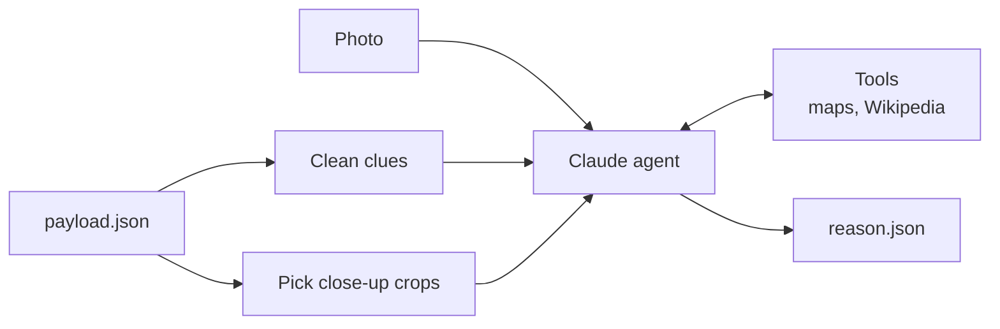

# Agent (Phase 2: Reason, Phase 3: Search)

Clues in, ranked places with evidence out. A Strands agent with Claude reads the clues the [image engine](../engine/README.md) prepared, links them, looks places up with its tools and says where the photo is likely from and why. Back to the [main README](../../../README.md).

Status: **in progress**. Reasoning works end to end; map and Wikipedia tools are built. What's left: [Roadmap](../../../README.md#roadmap).

## In and out

- **In:** the photo, cleaned clues and up to 6 close-up crops (built from `payload.json` by `app/modules/engine/prepare.py`).
- **Out:** `reason.json` (shape: `schemas.py`):
  - `summary`: best guess in one or two sentences
  - `candidates`: 1 to 5 places, ranked (country → city → area), each with confidence, evidence, clues against it, and coordinates when a lookup confirmed them
  - `search_queries`: searches it could not run yet, tagged `places`, `web`, `wiki` or `map`
  - `corrected_text`: OCR mistakes the model fixed, e.g. `DOCKTAILS → COCKTAILS`
  - `seen_in_image`: clues the model saw that Phase 1 missed
  - `sources`: every link a tool returned (see [Sources](#sources))

## How it works



1. **Clean the clues:** drop what the model does not need (pixel boxes, file paths, run info), merge repeats, keep confidence so weak clues stay weak.
2. **Pick crops:** the photo is shrunk before the model sees it, so small signs become unreadable. Close-ups of signs, shopfronts, streets and vehicles are cut from the full-size photo and sent with it.
3. **Reason and look up:** the agent fixes OCR mistakes, adds what it sees itself, links clues (language, brands, names, building style) and checks places with its [tools](#tools). Strands runs the loop: Claude picks a tool call, the tool runs, the result goes back, Claude decides again. Our code never decides the order.
4. **Structured answer:** the model must fill a fixed shape, so the result is checked and the next phase can read it directly.

Example on `samples/photo.jpeg` (a street café): sign read "A LA PLACE S^T GEORGES", plus Haussmann-style buildings, red awnings, rattan bistro chairs → **Paris, Place Saint-Georges (9th arrondissement), confidence 0.93**.

## Run

Needs `ANTHROPIC_API_KEY` in `.env`.

```bash
uv run python -m app.modules.engine samples/photo.jpeg --reason --out out/photo                                       # Phase 1 + 2
uv run python -m app.modules.engine samples/photo.jpeg --reason --from-payload out/photo/payload.json --out out/photo  # reuse a saved payload
```

The result prints and, with `--out`, is saved to `out/photo/reason.json`, next to `clues.json` and `sent/` (what was sent), so a wrong answer can be traced to its input. Every lookup is printed, e.g. `-> find_place(name="Place Saint-Georges", city="Paris", country="France")`, and the run ends with its tokens and cost, e.g. `tokens: input 3000, cache read 40000, cache write 8000, output 2500 ($0.0590)`.

## Tools

| Tool | Source | What it does |
|---|---|---|
| `find_place(name, city, country)` | OpenStreetMap Nominatim (free, no key) | A name read in the photo (shop, square, street, landmark) → real places with coordinates and an openstreetmap.org link, in English plus the local name |
| `reverse_geocode(lat, lon)` | OpenStreetMap Nominatim | Coordinates (e.g. EXIF GPS) → the address there |
| `wiki_search(query, lang)` | Wikipedia (free, no key) | Free text or a loose description ("clock tower downtown Beirut") → top articles with a short intro and coordinates. Handles misread OCR words (see below) |
| `wiki_summary(title, lang)` | Wikipedia | One article → description, full intro, coordinates and its name in other languages (local names help `find_place`) |
| `wiki_nearby(lat, lon, radius, keyword)` | Wikipedia | Coordinates → Wikipedia places around them, closest first, with distance; `keyword` keeps e.g. only churches |

The tools chain: one finds a candidate point, the others check it against the photo. If the photo has EXIF GPS, the agent starts there.

```
find_place / wiki_search / EXIF GPS ──► candidate point (lat, lon)
                                              │
              ┌───────────────────────────────┼──────────────────────────────┐
              ▼                               ▼                              ▼
   wiki_summary(title)            wiki_nearby(point, "church")      reverse_geocode(point)
   does it look like the photo?   is the church in the photo there? which street and area?
```

Try them by hand (no LLM):

```bash
uv run python -m app.modules.agent.tools "Place de l'Etoile" --city Beirut
uv run python -m app.modules.agent.tools --reverse 33.8959 35.5063
uv run python -m app.modules.agent.tools --wiki "Mohammad Al-Amin Mosque Beirut"   # --lang fr / ar
uv run python -m app.modules.agent.tools --wiki "intitle:/ayzeh/ Beirut"           # cut-off OCR word
uv run python -m app.modules.agent.tools --wiki-page "Mohammad Al-Amin Mosque"
uv run python -m app.modules.agent.tools --nearby 33.8955 35.5064 --keyword church --radius 500
```

Misread or cut-off OCR words in `wiki_search` (tested on Wikipedia search):

| Pattern | For | Example |
|---|---|---|
| `word~` | 1-2 wrong letters | `Nejmh~ square` → Nejmeh Square |
| `word*` | missing ending | `Mosq* Beirut downtown` → Mohammad Al-Amin Mosque |
| `intitle:/fragment/` | missing start or middle | `intitle:/ayzeh/ Beirut` → Rue Gouraud (Gemmayzeh) |

`?` and a leading `*` do not work. When a search finds nothing, the hints suggest these retries built from the query.

How the tools behave:

- **Retries:** if nothing is found, the tools return hints (fix the spelling, drop generic words, search the street, widen the area); the prompt says change one thing at a time and move on after 3 misses on one clue.
- **Lookup limit:** at most `AGENT_MAX_LOOKUPS` tool calls per run, enforced in code; then the agent answers with what it has.
- **Cache:** the same request in one run returns the saved answer (no network call). Failed answers are not cached.
- **Errors:** a timeout or bad answer comes back as `{"error": ...}`, so the agent retries or moves on instead of crashing.

### Sources

Every link a tool returns (Wikipedia articles, OpenStreetMap places) is kept by the `collect_sources` hook and saved as `sources` in `reason.json`: title, url, `wiki` or `map`, the tool, and `used` (its name appears in the answer). Links come only from real tool results, never from the model, so none is made up. The test UI lists them at the end of the Result tab, ★ = used.

### Choosing tools per run

A tool that is **on** is available: the agent calls it only if it helps. A tool that is **off** is removed completely: not given to the agent and not named in the prompt (each tool's hint comes from `TOOL_TIPS` in `constants.py`). With no tools, the agent answers from the photo and clues alone. The run log starts with `tools: ...`.

```bash
uv run python -m app.modules.engine samples/photo.jpeg --reason --tools find_place,wiki_nearby --out out/photo
uv run python -m app.modules.engine samples/photo.jpeg --reason --tools "" --out out/photo   # no tools
```

### Tool approval

Tools named in `NEEDS_APPROVAL` (`tools/__init__.py`) ask a person before every call; all tools so far are free, so the list is empty for now (`AGENT_APPROVAL=all` asks for every tool, handy to test). Answers: **yes** (run it), **no** (skip it, the agent goes on) or **all** (allow this tool for the rest of the run).

- **CLI:** asks in the terminal: `Allow find_place(...)? [y]es / [n]o / [a]ll:`.
- **Test UI:** a box in the Progress card with Yes / No / Allow all. The worker sends the request through Redis (`app/worker/live/approval.py`) and waits for the answer; no answer in `AGENT_APPROVAL_TIMEOUT` seconds counts as no.

```
Worker (agent job)                  Redis                       API + Browser
1. hook pauses the agent
2. saves the request       ──►  job:{id}:approval
   + `approval` event      ──►  job:{id}:log         ──►  3. events stream shows the box
                                                           4. you click Yes
                                job:{id}:answer      ◄──  5. POST /approval pushes "yes"
6. BLPOP gets "yes",       ◄──
   resumes (or no after AGENT_APPROVAL_TIMEOUT)
```

### Add a tool

1. Write it in its own file in `tools/` with `@tool`; the docstring is what Claude reads to decide when to use it.
2. If it calls a web API, use `ApiClient` (`tools/http.py`): timeout, User-Agent, wait between calls, cache, and errors as `ToolError`.
3. Add it to `TOOLS` in `tools/__init__.py` and a hint to `TOOL_TIPS` in `constants.py`. If it is paid or slow, add its name to `NEEDS_APPROVAL` too.

## Cost

- **Prompt caching** is on: the prompt, the tools and the conversation so far (photo and crops included) are cached on Anthropic's side, so each model call after the first in a run reads them at about 10% of the input price. The cache lives 5 minutes after its last use; changing the prompt, a tool docstring or the model starts a new one.
- **Spend:** every run adds one line (model, tokens, USD) to `out/spend.jsonl` (CLI and UI). Prices per model are in `PRICES` (`constants.py`). The test UI shows it in the top bar.

## Settings (`.env`)

| Setting | Default | Meaning |
|---|---|---|
| `ANTHROPIC_API_KEY` | (empty) | Required for `--reason` |
| `REASON_MODEL` | `claude-sonnet-5-5` | Claude model; `claude-opus-5-5` for hard photos |
| `REASON_MAX_TOKENS` | `16000` | Max length of the answer |
| `REASON_MAX_CROPS` | `6` | Close-up crops sent with the photo; `0` = photo only |
| `REASON_CACHE` | `true` | Prompt caching; `false` to turn it off (e.g. to compare cost) |
| `SPEND_LOG` | `out/spend.jsonl` | One line per reasoning run: tokens and USD |
| `CREDIT_BUDGET` | `0` | USD you topped up; the UI shows budget minus spent. `0` = hidden. An estimate: Anthropic has no balance API, so update it after a top-up |
| `AGENT_TOOLS` | (unset) | Tools the agent gets, comma-separated; unset = all, empty = none. CLI: `--tools`; UI: the Tools toggles |
| `AGENT_MAX_LOOKUPS` | `10` | Tool calls per run; more are cancelled |
| `AGENT_APPROVAL` | `listed` | Who asks first: `listed` = tools in `NEEDS_APPROVAL`, `all` = every tool, `none` = nothing asks |
| `AGENT_APPROVAL_TIMEOUT` | `300` | Worker jobs: seconds to wait for an answer, then no; `0` = wait forever |
| `PLACES_URL` | `https://nominatim.openstreetmap.org` | Map search service |
| `PLACES_TIMEOUT` | `10` | Seconds per map lookup |
| `TOOLS_CONTACT` | (empty) | Email or URL added to the User-Agent. **Needed for Wikipedia** (it answers 403 without a contact); OpenStreetMap asks for it too |
| `WIKI_URL` | `https://{lang}.wikipedia.org/w` | Wikipedia API base; `{lang}` = `en`, `fr`, `ar`... |
| `WIKI_TIMEOUT` | `10` | Seconds per Wikipedia lookup |

## Decisions

- **Clean before sending:** fewer tokens and less noise than raw Phase 1 output.
- **Crops, not a bigger photo:** the API shrinks large images anyway; crops keep detail only where it matters.
- **Honest confidence:** the prompt allows 0.9+ only with a decisive clue (GPS, a unique name, a famous landmark). No made-up city or street.
- **One agent that grows:** Phase 3 only adds tools to the Phase 2 agent; nothing else changes.

## Open discussions

### Which sources for Search?

No single source finds everything, so each kind of clue should go to the source best at it.

| Source | Good for | Example clue | Status |
|---|---|---|---|
| Maps (OpenStreetMap, Google Places) | Shop and venue names, streets, squares | "Brasserie Place St Georges" | OSM built |
| Wikipedia / Wikidata | Landmarks, monuments, famous buildings | A clock tower or a mosque dome | Wikipedia built |
| Web search | Sign text, phone numbers, brands, events | "+961" phone number on a sign | Planned |
| Street photos (Mapillary, Street View) | What a spot looks like from the street | Does the shopfront match? | Planned |
| Reviews and listings | Visitors' photos of cafés, hotels, venues | Same tables, menu or interior | Planned |

- Free first (OpenStreetMap, Mapillary, Wikipedia), or paid (Google) for better coverage?
- How many search rounds before it stops and asks a person?
