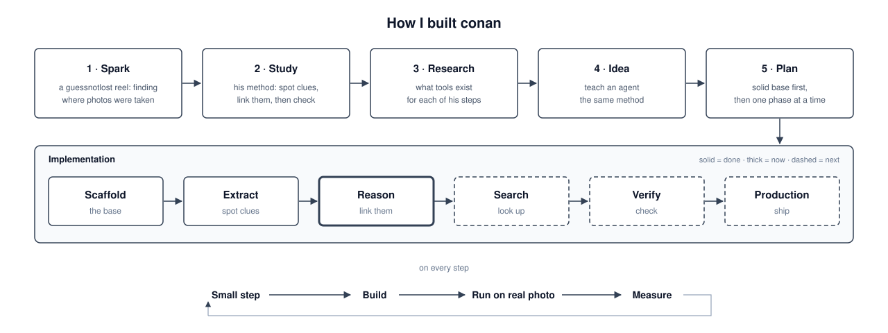
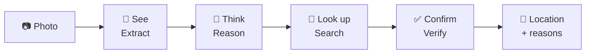
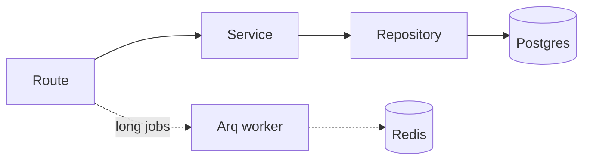
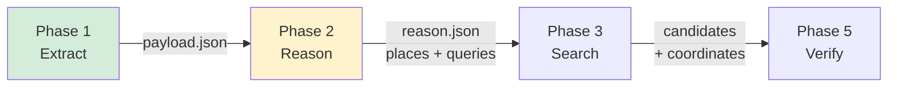
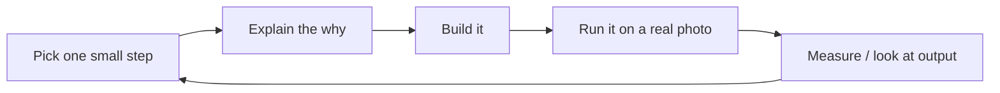

# How I built conan

A short case study of how I approached this project: what I did first, in what order, and why.

## 1. Where the idea came from

- **Spark:** I saw a reel by [guessnotlost](https://www.instagram.com/guessnotlost/) on Instagram, finding where a photo was taken, by hand.
- **Study:** I watched how he did it: spot small clues (signs, shops, buildings), link them together, search, then check.
- **Research:** I looked for tools that could do each of his steps.
- **Idea:** teach an agent the same method.

## 2. Start from the problem

**Goal:** give it a photo, get back *where* it was taken, and *why*.

I broke it down the way a human geo-detective works, so each part could be built and checked alone:

## 3. Scaffold first, features second

Before any AI code, I set up the backend a real product would need. Adding features later is easy; fixing a weak base is not.

| Choice | Why |
|---|---|
| Route → service → repository layers | Each layer has one job; easy to test and change |
| One commit per request | No half-saved data on errors |
| Base repository with CRUD | New models need almost no code |
| Arq worker | Geolocation runs are slow, so they shouldn't block requests |
| Typed errors, one error shape | Clients always get `{"error": {code, message}}` |

## 4. Build in phases, each with a clear output

Each phase writes a file the next phase reads. So I can rerun one phase without the others, and inspect what passed between them.

🟩 done · 🟨 in progress · ⬜ next

**Phase 1: Extract (local, no LLM)**
- Objects (Grounding DINO), text in Arabic + English (PaddleOCR), EXIF.
- CLI before API: fastest way to try it on real photos.
- Every run logs time, CPU, GPU and RAM, so I tune with numbers, not guesses.

**Phase 2: Reason (Claude via Strands)**
- Clean the raw output into short clues before the LLM sees it (less noise, fewer tokens).
- Send close-up crops of signs and shops, not just the full photo.
- Structured answer: ranked places, confidence, evidence, and search queries for Phase 3.
- A small test UI to run a photo and see what went in and what came out.

## 5. How I work, step by step

- One small piece at a time, never a whole feature at once.
- Always run it end to end on a real photo before moving on.
- Keep the docs and roadmap up to date as I go ([README](../README.md#roadmap)).

## 6. Principles I kept

- **Local first:** cheap, private extraction before paying for an LLM call.
- **Evidence over guesses:** every answer comes with the clues behind it.
- **Narrow step by step:** world → region → a few places → one spot.
- **Human in the loop:** a person approves tool use and confirms the final answer.

## What's next

Phase 3 gives the agent search tools, Phase 4 adds a vector DB (RAG), Phase 5 checks candidates against reference photos, then runs move into the worker and Postgres (with PostGIS). Full list: [Roadmap](../README.md#roadmap).
