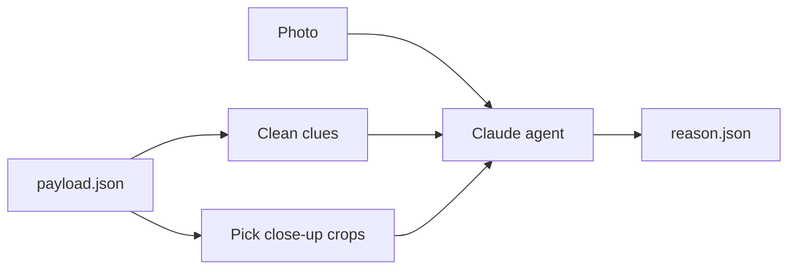

# Phase 2: Reason

Clues in, ranked guesses out. A Strands agent with Claude looks at the photo and the Phase 1 clues, links them, and says where the photo is likely from and why. No tools yet: it can think, but not look things up (that is Phase 3).

Status: **in progress**. Works end to end; testing on more photos.

## In and out

- **In:** `payload.json` from Phase 1, plus the photo.
- **Out:** `reason.json` (shape: `app/modules/agent/schemas.py`):
  - `summary`: best guess in one or two sentences
  - `candidates`: 1 to 5 places, ranked (country → city → area), each with confidence, evidence and clues against it
  - `search_queries`: what Phase 3 should look up first, tagged `places`, `web`, `wiki` or `map`
  - `corrected_text`: OCR mistakes the model fixed, e.g. `DOCKTAILS → COCKTAILS`
  - `seen_in_image`: clues the model saw that Phase 1 missed

Run it: `uv run python -m app.modules.engine samples/photo.jpeg --reason --out out/photo` (more options in the [README](../README.md#reasoning-agent-phase-2-reason)).

## How it works

1. **Clean the clues:** drop what the model does not need (pixel boxes, file paths, run info), merge repeats, keep confidence so weak clues stay weak.
2. **Pick crops:** the photo is shrunk before the model sees it, so small signs become unreadable. Up to 6 close-ups of signs, shopfronts, streets and vehicles are cut from the full-size photo and sent with it.
3. **Reason:** the agent fixes OCR mistakes, adds what it sees itself, links clues (language, brands, names, building style) and ranks places.
4. **Structured answer:** the model must fill a fixed shape, so the result is checked and Phase 3 can read it directly.

## Example

On `samples/photo.jpeg`, a street café:

- Sign read: "A LA PLACE S^T GEORGES"
- Supporting clues: Haussmann-style buildings, red awnings, rattan bistro chairs
- Guess: **Paris, Place Saint-Georges (9th arrondissement), confidence 0.93**
- Next: 2 search queries for Phase 3 to confirm it

## Steps

| # | Step | What it does | Status |
|---|---|---|---|
| 1 | Clean clues | Turn the payload into a short clue list (`app/modules/engine/prepare.py`) | Done |
| 2 | Result shape | Fixed output the model must fill (`app/modules/agent/schemas.py`) | Done |
| 3 | Agent | Strands + Claude, photo + clues in, result out (`app/modules/agent/reason.py`) | Done |
| 4 | Close-up crops | Send the most useful object crops with the photo (`app/modules/engine/prepare.py`) | Done |
| 5 | Test UI | Upload a photo, watch the run, see what went in and came out | Done |
| 6 | More photos | Test on harder photos, improve the prompt | In progress |
| 7 | Honest confidence | Check that 0.9 means right about 9 times in 10 | Planned |

## Decisions

- **Clean before sending:** fewer tokens and less noise than sending raw Phase 1 output.
- **Crops, not a bigger photo:** the API shrinks large images anyway; crops keep detail only where it matters.
- **Honest confidence in the prompt:** 0.9+ only with a decisive clue (GPS, a unique name, a famous landmark). No made-up city or street.
- **Save what was sent:** `clues.json` and `sent/` are saved next to the result, so a wrong answer can be traced to its input.
- **Same agent grows in Phase 3:** tools are added to it; nothing else changes.
- **Model:** `claude-sonnet-5-5` by default, `claude-opus-5-5` for hard photos (`REASON_MODEL` in `.env`).
