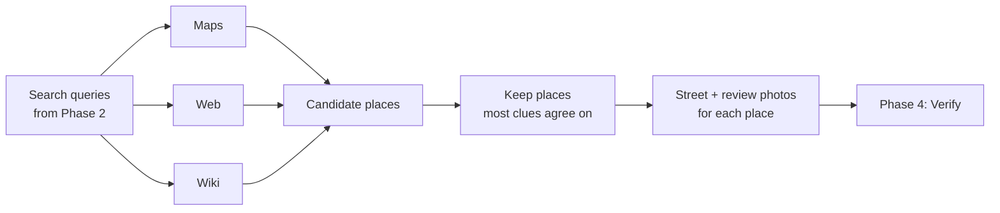

# Phase 3: Search

Candidate regions in, real places with coordinates out. The agent gets tools to look things up, the way a person would open maps, search the web and look at street photos.

Status: **in progress**. Step 1 (map tools) built in `app/modules/agent/tools/places.py` and passed to the agent; it calls them during a `--reason` run.

## In and out

- **In:** `reason.json` from Phase 2: ranked candidates (country, city, area, evidence) and `search_queries`, each tagged `places`, `web`, `wiki` or `map`.
- **Out:** a short list of real places, each with name, coordinates, the clues that match it, and reference photos for Phase 4 (Verify).

## Many sources, one per kind of clue

No single source finds everything. Each clue goes to the source that is best at it.

| Source | Good for | Example clue |
|---|---|---|
| Maps / places (OpenStreetMap, Google Places) | Shop and venue names, streets, squares | "Brasserie Place St Georges" |
| Web search | Sign text, phone numbers, brands, events | "+961" phone number on a sign |
| Wikipedia / Wikidata | Landmarks, monuments, famous buildings | A clock tower or a mosque dome |
| Street photos (Mapillary, Street View) | What a spot looks like from the street | Check if the shopfront matches |
| Reviews and listings | Visitors' photos of cafés, hotels, venues | Same tables, menu or interior |

If the photo has EXIF GPS, the agent starts there: one map lookup to name the spot, then straight to Verify.

## How it narrows down

- Each clue gives a few possible places, and the next clue rules some out.
- A place is kept only if more than one clue points to it.
- If nothing matches, the agent writes new queries from the clues it has not used yet, then searches again.

## Human in the loop

- A person approves tool use before paid or slow lookups run. Built: tools in `NEEDS_APPROVAL` pause the agent; the person answers yes, no, or all (allow that tool for the rest of the run). `AGENT_APPROVAL=all` asks for every tool.
- A person can stop the search, or send it back to search deeper.

## Steps

| # | Step | What it does | Status |
|---|---|---|---|
| 1 | Map / place tool | `find_place` (name near a city -> coordinates) and `reverse_geocode` (GPS -> address), OpenStreetMap Nominatim | Done |
| 2 | Web search tool | `@tool` for sign text, phone numbers, brands | Planned |
| 3 | Wiki tool | `@tool` for landmarks | Planned |
| 4 | Run Phase 2 queries | Agent runs `search_queries` first, then writes its own | Planned |
| 5 | Merge and rank | Join results from all sources, keep places with the most matching clues | Planned |
| 6 | Reference photos | Fetch street and review photos for each kept place | Planned |
| 7 | Keep context small | Summarise old tool results so long runs stay within limits | Planned |

## Open questions

- Free first (OpenStreetMap, Mapillary, Wikipedia), or paid (Google) for better coverage?
- How many search rounds before it stops and asks a person?
